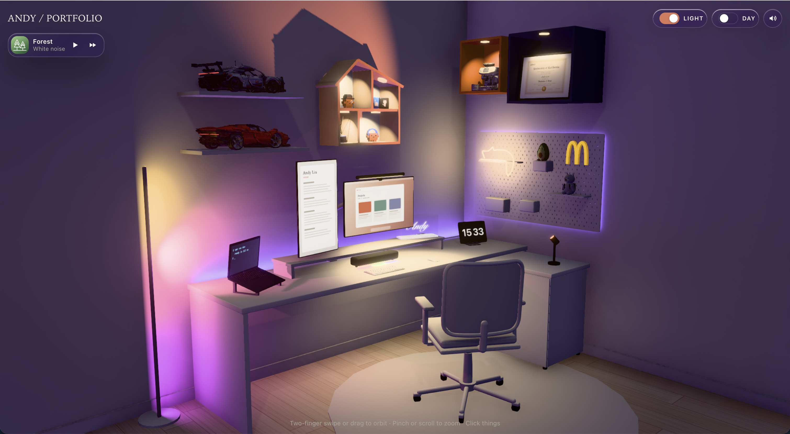
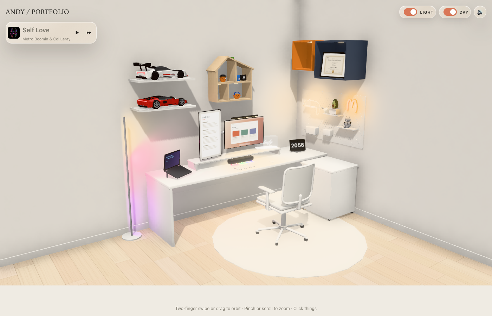

# Portfolio Room — Interactive 3D Room Portfolio

> By Andy Liu
> Live demo: https://andy-liu-portfolio.vercel.app/
>
> **Showcase only.** This repository presents the idea and the result. It
> contains no source code, no 3D model assets, and nothing runnable — the
> full implementation stays private. If you want to experience the site,
> open the live demo above.

## What it is

A personal portfolio presented as a room, not a page. My real desk setup,
rebuilt as an interactive 3D room in an IKEA-style look: a white desk and
chair, a sunset floor lamp, toy cars on wall shelves, a diploma in a wall
cube, a neon sign, and a clock showing the real time.

There is no navigation menu. The room *is* the navigation.

## How to play

- **Orbit:** drag (or two-finger swipe) to look around the room
- **Zoom:** scroll or pinch
- **Click things** — every section of the portfolio lives inside an object:
  - The **desk monitor** → Projects, four selected works
  - The **house-shaped wall shelf** → About me, with contact links
  - The **document standing on the desk** → Resume: a Journey timeline
    plus skill bricks with "where used" notes
  - The **toy cars** → Hobbies
  - The **framed certificate in the navy-blue wall cube** → Diploma
- **Toggles, top right:** light on/off, day/night, sound
- **Music player, top left:** a small widget that plays while you explore

## The idea

A normal portfolio asks visitors to scroll. This one asks them to look
around. Putting the content inside objects does three things:

1. **It is memorable.** People remember a room they walked through better
   than a page they scrolled past.
2. **It stays honest.** The room is my actual desk — the objects are things
   I really own and like (LEGO cars, a sunset lamp, the diploma), so the
   site feels like a place rather than a template.
3. **It keeps the content calm.** Each panel is a small frosted-glass card
   with one thing on it: a bio, a timeline, four projects. Nothing shouts.

Day and night are not just a theme switch: lamps, the neon sign, and the
sunset lamp change how the whole room feels, so the same space reads
completely differently after dark.

## Architecture, in words

The implementation is layered so content and presentation stay separate:

- **`scene/`** — the 3D room itself: the layout, the lighting, the
  interactable objects, and the camera controls (orbit, zoom, click).
- **`ui/`** — everything floating above the room: the overlay panels, the
  light/day/sound toggles, and the music player.
- **`content/`** — the portfolio content: bio, journey, skills, projects,
  hobbies, diploma. Written once, rendered wherever the room needs it.
- **`lib/`** — shared helpers: state and small utilities the other layers
  use.

The rule behind the split: changing what the portfolio *says* should never
mean rebuilding the room, and changing how the room *looks* should never
mean rewriting the content.

## Stack

Vite · React 19 · React Three Fiber 9 · drei · three.js ·
postprocessing · zustand · TypeScript

## Note on reuse

Please do not copy the design, the room, or the screenshots into your own
site. The concept is shared here for viewing; the code and the 3D assets
are not licensed for reuse.
